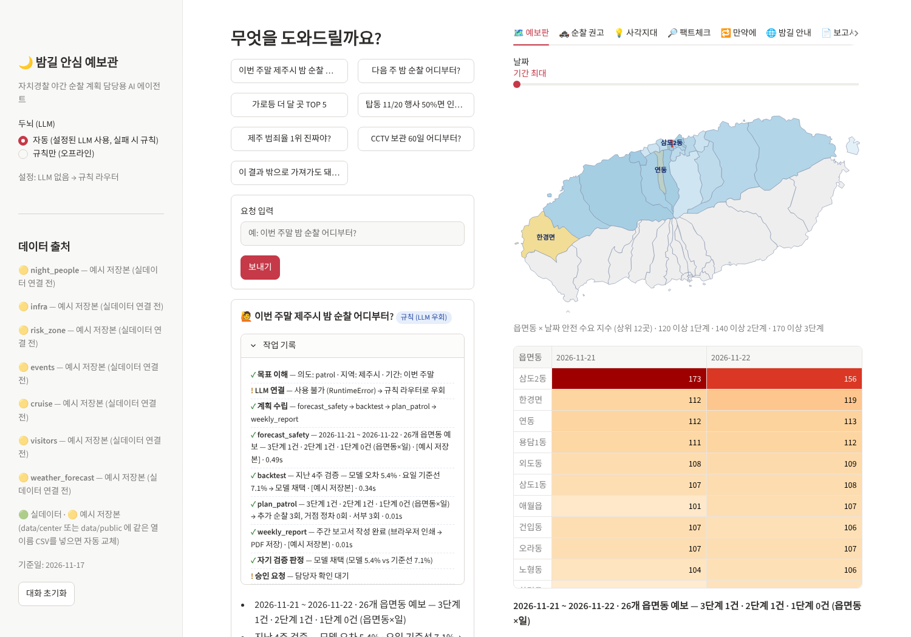

# 🌙 밤길 안심 예보관 — 2안-A AI 에이전트

제주자치경찰단 야간 순찰 계획 담당자가 **질문 한 줄**로 다음 7일 읍면동별 야간 안전 수요 예보, 순찰 권고표, 조명·CCTV 보강 후보, 보고서까지 받아 가는 AI 에이전트.

> 제주 AI·빅데이터 활용 AI Agent 개발 챌린지 · 팀 미나리 백김치 · 기능·데이터 명세: [`../docs/spec/2안A_기능명세서.md`](../docs/spec/2안A_기능명세서.md)



## 1. 바로 실행

### Windows (센터 PC)
1. Python 3.10 이상 설치 확인 (`python --version`)
2. 이 폴더의 **`run.bat` 더블클릭** — 처음 한 번은 설치에 몇 분 소요
3. 브라우저가 열리면 왼쪽 예시 질문 버튼 클릭

### Mac·Linux
```
./run.sh
```

LLM 없이도 전체 기능 동작 (규칙 라우터). LLM을 쓰려면 아래 3번 참고.

## 2. 사용 방법

| 이렇게 물어보면 | 에이전트가 하는 일 | 받아 가는 것 |
|---|---|---|
| 이번 주말 제주시 밤 순찰 어디부터? | 예보 → 자기 검증 → 순찰 권고 → 보고서 | 예보판 지도, 순찰 권고표, 보고서 |
| 다음 주 밤 순찰 어디부터? | 지역이 없으면 **되묻기** (제주도 전체 / 제주시 / 서귀포시) | 위와 같음 |
| 가로등 더 달 곳 TOP 5 | 밤 인원 많고 어두운 곳 순위 | 보강 후보와 근거 수치 |
| 탑동 11/20 행사 50%면 인력 얼마나? | 조건 바꿔 다시 계산 → 순찰 권고 | 등급 변화, 추가 순찰 횟수 |
| 삼도2동에 가로등 300개 추가하면? | 조명 보강 효과 계산 | 지수 변화 |
| 제주 범죄율 1위 진짜야? | 공식 통계로 판정 | 판정, 공식·비공식 수치, 출처, 실제 노력 |
| CCTV 보관 60일 어디부터? | 우선구역 선별·비용 계산 | 우선구역, 비용 절감 추정 |
| 이 결과 밖으로 가져가도 돼? 제주시 | 반출 기준 검사 | 검사 결과, 반출 신청서 초안 |

화면 구성
- **왼쪽**: 질문 입력, 작업 기록 (✓ 성공 · ✗ 실패 · ! 우회·확인 필요, 단계별 소요 시간)
- **오른쪽 탭**: 예보판 · 순찰 권고 · 사각지대 · 팩트체크 · 만약에 · 밤길 안내(한·중·영) · 보고서 · 반출 · 검증
- 화면 예: [순찰 권고](docs/screen_patrol.png) · [팩트체크](docs/screen_fact.png) · [만약에](docs/screen_simulate.png)
- **아래**: 담당자 확인 사항, [수정 요청] [승인] — 승인·현장 결과는 `data/feedback/feedback.sqlite`에 기록 (데이터 선순환)

## 3. LLM(두뇌) 설정

`.env` 파일 (처음 실행 시 `.env.example`에서 자동 생성)

| 방식 | 설정 | 특징 |
|---|---|---|
| 규칙만 (기본) | `LLM_PROVIDER=none` | 인터넷·키 불필요, 정해진 질문 유형에서 안정 동작 |
| Claude API | `LLM_PROVIDER=anthropic`, `ANTHROPIC_API_KEY=...` | 자유로운 질문 이해·문장 품질 최고 |
| OpenAI API | `LLM_PROVIDER=openai`, `OPENAI_API_KEY=...` | 같음 |
| 로컬 (Ollama) | `LLM_PROVIDER=ollama`, `ollama pull qwen2.5:3b` 후 실행 | 인터넷 불필요, GTX 1060(3GB)에 맞는 3B 모델 |

- LLM 연결 실패·시간 초과 시 **자동으로 규칙 라우터로 우회**하고 작업 기록에 `!` 표시
- LLM은 **도구 선택과 문장 작성만** 담당. 모든 숫자는 `tools/safety.py` 코드 계산
- 평가용 API 키는 사용 한도를 설정해 제출, 저장소에는 절대 올리지 않음

## 4. 데이터

| 우선순위 | 폴더 | 내용 |
|---|---|---|
| 1 | `data/center/` | 센터 PC에서 집계한 센터 데이터 (반출하지 않음, 저장소 미포함) |
| 2 | `data/public/` | 허브·공공데이터포털에서 받은 공개 데이터 |
| 3 | `data/sample/` | **예시 저장본** — 실데이터 연결 전에도 전체 흐름 확인용 |

- 같은 파일명·열 이름의 CSV를 위 폴더에 넣으면 자동 교체. 필요한 열은 각 폴더 README 참고
- 화면 사이드바에 데이터별 출처 표시 (🟢 실데이터 · 🟡 예시 저장본), 결과에도 `[예시 저장본]` 표시
- 읍면동 경계 `data/ref/jeju_emd.geojson`: 실제 행정동 경계 (통계청, vuski/admdongkor ver20250401, 43개 읍면동)
- 예시 저장본 재생성: `python scripts/make_sample_data.py`

## 5. 계산 방식

```
안전 수요 지수 = 100 × 인원비 × √(위험 가중 × 밝기·감시 부족) × 규모계수
  인원비       = 예보 밤 인원 ÷ 지난 4주 같은 요일 기준선
  예보 밤 인원 = 기준선 × 연휴 전날·비·방문객 추세·행사 계수 + 크루즈 체류 인원
  위험 가중    = 경찰서 권역 5대 범죄 (1.0 기준, 0.85~1.2)
  밝기·감시 부족 = 도로 km당 가로등·CCTV 밀도의 역수 (1.0 기준, 0.85~1.25)
  규모계수     = (동네 기준선 ÷ 전체 중앙값)^0.1
등급: 120 이상 1단계 · 140 이상 2단계 · 170 이상 3단계
```

- 비·연휴 전날 계수는 과거 자료로 유형(도심·관광·주거)별 학습
- 자기 검증: 지난 4주를 가리고 예보 → 오차(MAPE)가 요일 기준선보다 나쁘면 기준선 채택
- 범죄 건수는 예측하지 않음 (공개 범죄 통계가 연·경찰서 단위라 검증 불가)

## 6. 설계 원칙 (민감 주제)
- 국적·성별·연령 등 개인 속성은 점수에 쓰지 않음
- 개별 사건은 다루지 않고 공식 통계만 인용
- 외부 공개 안내문은 등급 대신 '밝은 길 안내' 형태
- 보정 범죄율은 '비공식'과 계산 방식을 함께 표시

## 7. 폴더 구조
```
app.py                 Streamlit 화면
agent/core.py          에이전트 루프 (목표 이해 → 계획 → 도구 → 검증 → 승인)
agent/llm.py           Claude · OpenAI · Ollama 연결
agent/router.py        규칙 라우터 (LLM 없을 때·실패 시)
tools/safety.py        계산 도구 (예보·검증·순찰·사각지대·CCTV·팩트체크·반출 검사)
tools/docs.py          보고서·밤길 안내문
tools/registry.py      도구 목록·스키마·실행
tools/data_layer.py    센터 → 공개 → 예시 순 데이터 선택
data/ref/              읍면동 경계·메타, 공휴일, 팩트체크 근거 카드
tests/test_agent.py    재현성 테스트 (python -m pytest -q)
```

## 8. 한계·확인 필요
- 현재 수록된 밤 인원·가로등·CCTV·권역 범죄 수치·행사·날씨는 **예시 값** — 실데이터 연결 후 다시 실행 필요
- 공개 유동인구 API는 하루 합계라 밤 비중은 가정값, 센터 PC에서 4-11 시간대 값으로 교체
- 권역(동부·서부·서귀포)은 경찰서 관할 근사 매핑
- 크루즈 1척당 밤 체류 450명, CCTV 보관 연장 비용의 대수 비례는 가정값

## 9. 사용 오픈소스·외부 자료
Streamlit, pandas, NumPy, Shapely, Plotly, Matplotlib, python-dotenv, anthropic, openai (선택), pytest · 행정동 경계 vuski/admdongkor · 팩트체크 수치: 국가데이터처 한국의 사회지표, 세계일보 2026.8.29, 노컷뉴스 2026.10.15, 제이누리 2026.9
